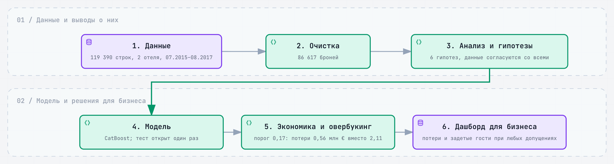
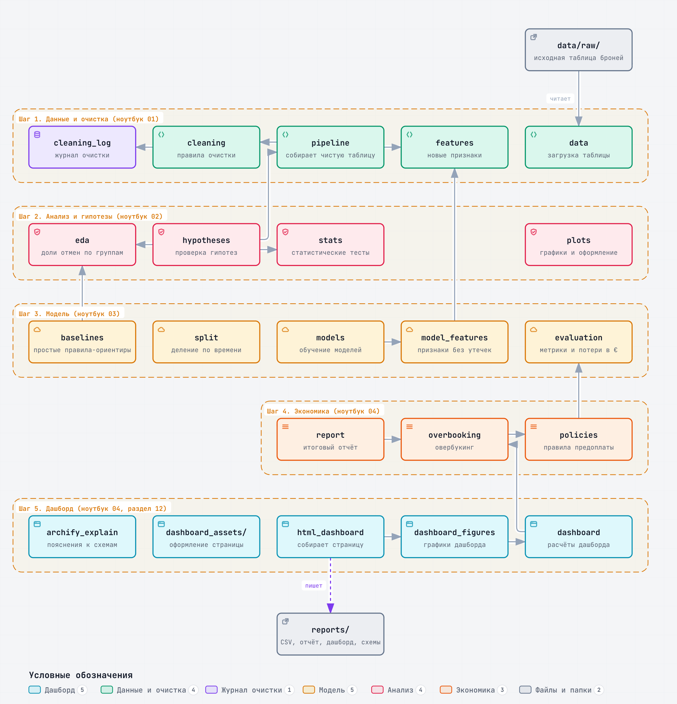
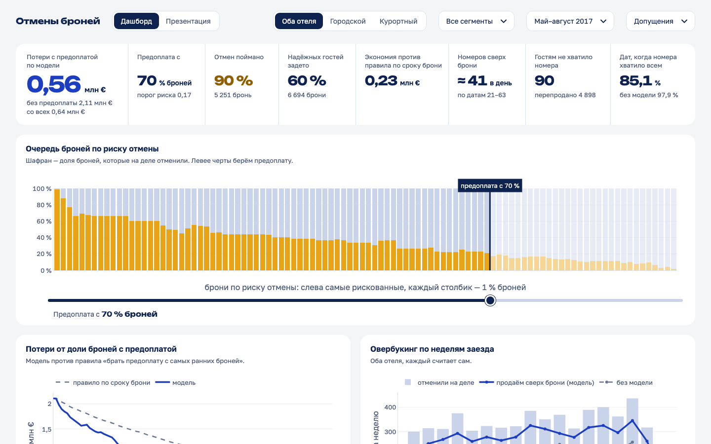
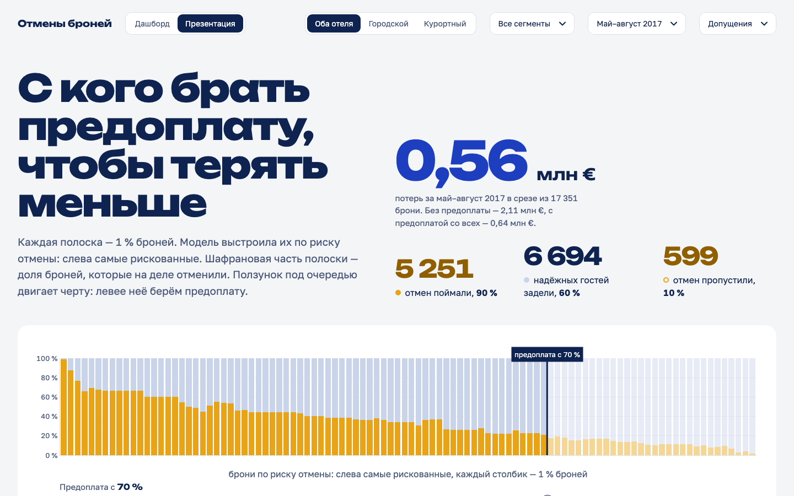

# Отмены бронирований в отелях: прогноз и политика предоплаты

Итоговый проект программы ДПО НИУ ВШЭ «Аналитика данных».

**Вопрос:** какие брони отменят и сколько отель сэкономит, если брать предоплату только с
рискованных броней?

## Ход работы



Каждый шаг — отдельный ноутбук в `notebooks/` с пояснениями и выводами: 01 — загрузка и очистка, 02 — анализ и
гипотезы, 03 — модель, 04 — экономика предоплаты и овербукинга. Итог собран в дашборде `reports/dashboard.html` — **[открыть дашборд в браузере](https://obivanio.github.io/hotel-cancellations-hse/reports/dashboard.html)**.

## Главные выводы

### Что нашли

Отменяется 27,7 % броней (37,3 % номеров, если считать каждый номер групповой брони), и доля отмен растёт: 24,7 %
на обучающем периоде, 29,3 % на валидации и 34,8 % на тесте. Чаще отменяют ранние брони (41,0 % при брони больше
чем за год против 8,5 % за неделю) и брони через онлайн-агентства (35,5 % против 12–15 % у прямых и корпоративных),
реже — повторные гости и гости со спецзапросами. Всё это связь, а не причина.

Модель CatBoost видит только то, что известно в момент брони: колонки, которые заполняются после брони (итог брони,
выданный номер, число изменений), исключены, а на всякий случай — и парковка со страной: их, возможно, уточняют при
заезде. Модель настраивали на валидации, а тест (заезды май–август 2017 года) открыли один раз в конце. Качество на
тесте — PR-AUC 0,626 (от 0 до 1: насколько хорошо модель ставит будущие отмены выше остальных броней). Угадывание
наугад даёт 0,348 — просто долю отмен на тесте, лучшее простое правило «срок брони + сегмент» — 0,471.

### Что советуем бизнесу

Предоплата нужна в любом случае: без неё отель на тесте теряет 2,11 млн €. Если брать её с броней, у которых риск
отмены по модели выше 0,17 (порог выбран на валидации), это 70 % броней, а потери падают до 0,56 млн €. Правило «со
всех» даёт 0,64 млн €: основная экономия — от самой предоплаты, модель добавляет около 0,08 млн €. Но при этом
пороге предоплату попросят и у 60 % надёжных гостей — тех, кто и так бы приехал. Если это много, есть мягкий
вариант: предоплата с 50 % самых рискованных броней — потери 0,66 млн €, задето 37 % надёжных гостей. Выбор между
деньгами и гостями — решение бизнеса. Если предоплату берут не со всех, брони лучше выбирать моделью, а не по сроку
брони: при 70 % броней потери 0,56 против 0,79 млн € — эту экономию 0,23 млн € показывает дашборд.

Овербукинг по модели даёт около 3,15 млн €, но это верхняя оценка: считаем, что на каждый перепроданный номер
найдётся покупатель; реальная добавка может быть примерно вдвое меньше. В городском отеле модель переоценивает
отмены, и осторожная оценка перебрала в 27 % дат вместо обещанных не более 10 %, потому что группы отменяют много
броней сразу, а поправка вероятностей общая для двух отелей. Поэтому овербукировать стоит по каждому отелю отдельно
и с запасом.

### Ограничения

Данные — два отеля в Португалии с заездами 2015–2017 годов, на другие отели выводы переносятся с осторожностью.
Идентификатора брони нет, поэтому одинаковые строки склеены в групповые брони — это обоснованное предположение, а
не факт. Вместимости отелей в данных нет, поэтому овербукинг считается сверх забронированного, а не сверх свободных
номеров, и денежные допущения (половина стоимости отменённой брони не перепродаётся, 10 % надёжных гостей уходят
из-за предоплаты) взяты не из данных; их влияние проверено в ноутбуке 04. Итоги предоплаты и овербукинга нельзя
складывать: оба решения опираются на одни и те же отмены. Доля отмен растёт со временем, поэтому модель придётся
переобучать.

## Данные

Hotel Booking Demand — 119 390 броней двух отелей в Португалии (городской и курортный),
заезды с июля 2015 по август 2017, 32 признака.
Источник: Antonio, Almeida, Nunes. *Hotel booking demand datasets*. Data in Brief, 2019.

Датасет скачивается автоматически при первом запуске (`src/data.py`) в `data/raw/`.

## Структура

```
src/          код: загрузка (data), очистка (cleaning, cleaning_log), признаки (features), сборка (pipeline),
              разведочный анализ (eda), статистика (stats), гипотезы (hypotheses), графики (plots),
              модель: сплит (split), признаки модели (model_features), правила (baselines), модели (models),
              оценка и порог (evaluation); экономика: правила предоплаты (policies), овербукинг (overbooking),
              интерактивный отчёт (report), дашборд: расчёты (dashboard), сборка (html_dashboard),
              пояснения к схемам (archify_explain); шаблон, стили и логика страницы — src/dashboard_assets/
diagrams/     исходники схем archify 19, 20, 23–25, русский интерфейс просмотрщика, пояснения шагов
static/fonts/ шрифты дашборда Golos Text и Unbounded (лицензия OFL)
tests/        тесты pytest
notebooks/    ноутбуки с ходом работы и выводами (01 — загрузка и очистка, 02 — анализ и гипотезы, 03 — модель,
              04 — экономика предоплаты и овербукинга)
data/raw/     исходные данные (скачиваются автоматически, не хранятся в git)
data/processed/  очищенный датасет (создаётся ноутбуком, не хранится в git)
models/       обученная модель CatBoost
reports/      артефакты: журнал очистки, таблица гипотез, метрики моделей, таблицы правил и овербукинга,
              интерактивный отчёт report.html и дашборд dashboard.html (открываются в браузере без Python),
              графики и схемы (figures/)
```



Стрелки на схеме показывают, кто чьи функции использует.

## Запуск

```bash
python3 -m venv .venv && source .venv/bin/activate
pip install -r requirements.txt && pip install -e .
jupyter notebook notebooks/
```

## Дашборд

Открыть онлайн: [дашборд](https://obivanio.github.io/hotel-cancellations-hse/reports/dashboard.html) · [презентация](https://obivanio.github.io/hotel-cancellations-hse/reports/dashboard.html#presentation) · [интерактивный отчёт](https://obivanio.github.io/hotel-cancellations-hse/reports/report.html)





Откройте `reports/dashboard.html` двойным щелчком — нужен только браузер (работает в Safari и Chrome), интернет и Python не
нужны (файл ≈ 6,6 МБ, все графики на Plotly). У страницы два вида: «Дашборд» (показатели и графики на одном экране, открывается по умолчанию) и «Презентация» (рассказ с пояснениями и схемами); переключатель — вверху, ссылка `reports/dashboard.html#presentation` открывает сразу презентацию. Вверху выбираются отель, сегменты, месяцы заезда и допущения о деньгах; черту на очереди броней двигает
ползунок под очередью (мышью или стрелками). Схемы внизу страницы берутся из соседней папки `reports/figures/`, поэтому пересылать
нужно всю папку `reports`.

Пересобрать дашборд после изменения данных или кода:

```bash
python -m src.html_dashboard        # reports/dashboard.html из reports/scored_test.csv, overbooking.csv, policies.csv
python -m src.archify_explain       # пояснения шагов в схемах 19 и 20 (после пересборки схем archify)
```

Тест сверки расчётов браузера с Python (`tests/test_dashboard_js.py`) запускает Node.js; без Node он пропускается.

## Проверка кода

```bash
pytest
flake8 src tests
pylint src tests
nbqa flake8 notebooks/
```

Интеграционные тесты (`test_real_data_*`) работают на настоящем датасете: при первом запуске он
скачивается автоматически, поэтому нужен доступ в интернет.
